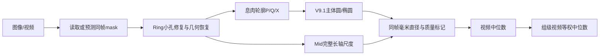

# DXY-MID：参考环辅助的息肉直径测量

本项目从内镜图像及同帧多类mask测量息肉主体直径。唯一正式算法为 **V9.1 Geometry + 原图Mid尺度 + 视频等权中位聚合**。它保留边界证据、质量标记及真实失败，不通过其他方法的预测补值。

**[39组Excel下载](mainline/tables/group_results.xlsx?raw=true)** · [39组CSV](mainline/tables/group_results.csv) · [79段视频结果](mainline/tables/video_results.csv) · [790帧质量记录](validation/results/frame_measurements.csv)

## 原理



- **Ring**：只填充符合冻结规则的小型封闭背景孔；由可见弧段恢复内外环及中心线，保留拟合失败。
- **P/Q/X**：P是可信可观察边界，Q是受环遮挡的弱约束，X为不可用证据。Q始终来自原始息肉轮廓，保留轮廓索引与外法向软区间；跨环背景邻接判断提供遮挡证据。短Q弧按冻结规则过滤。
- **Geometry**：既有A/B主体候选、RANSAC圆、稳健椭圆与圆优先选择；保留P主导、方向互补Q、Q冲突恢复及稳定性诊断。绘图使用实际选中的形状与测量轴，不重新拟合。
- **Mid尺度**：原图坐标下，使用已验证实现的中心线椭圆完整长轴；不仿射拉伸息肉。线材圆截面直径1.2mm，R5/R10的中心线物理直径分别为6.2/11.2mm。

\[
s_i=\frac{D_{\mathrm{inner}}+1.2}{2a_{\mathrm{mid},i}},\quad D_i=L_{\mathrm{polyp},i}s_i
\]
\[
D_{\mathrm{video}}=\operatorname{median}(D_i),\quad D_{\mathrm{group}}=\operatorname{median}(D_{\mathrm{video}})
\]

先算同帧毫米值，视频等权；不能将像素长度和尺度分别取中位再相乘。详见[Python API与六组件](docs/API.md)。


[完整过程图](docs/visualization/README.md)展示Ring恢复、P/Q、主体候选、Q恢复及硬失败，附真实点位与数值证据。

## 安装与运行

Ubuntu / Python 3.10；已有mask的测量不需要GPU或Torch。

```bash
python3 -m venv .venv
.venv/bin/python -m pip install '.[plot,test,report]'
OPENBLAS_NUM_THREADS=1 OMP_NUM_THREADS=1 .venv/bin/dxy-mid measure \
  --manifest examples/mask_demo/frames.csv --output outputs/demo --workers 1 --render
```

```python
from dxy_mid import measure_files
result = measure_files("frame.jpg", "labels.png", inner_diameter_mm=5.0)
print(result.audit["D_frame_mm"], result.audit["quality_class"])
```

Mask为同尺寸单通道uint8：0背景、1息肉、2参考环。批处理manifest记录source_id、group、video、stem、ring_mm、image_path、mask_path；相对路径依据manifest或`--data-root`解析。参数配置为[configs/dxy_mid.json](configs/dxy_mid.json)。[环境与数据契约](docs/DATA_MODEL.md)说明全部字段、依赖及模型预处理。

## 真实公开复现

仓库包含6组27帧原始JPEG与mask。其中Is 10.5 R5组的20帧覆盖两段视频的完整冻结选帧；其他组为机制子集，不能据其复现完整组级结果。无需权重或额外下载：

```bash
# 27帧机制样例，含真实Ring失败
OPENBLAS_NUM_THREADS=1 OMP_NUM_THREADS=1 .venv/bin/python scripts/reproduce_public.py \
  --case all --output outputs/public --workers 2
# 完整两视频组：20帧 → 两视频中位 → 10.2093871774 mm
OPENBLAS_NUM_THREADS=1 OMP_NUM_THREADS=1 .venv/bin/python scripts/reproduce_public.py \
  --case multivideo --output outputs/public-videos --workers 2
# 硬失败保持NaN；脚本验证失败身份
.venv/bin/python scripts/reproduce_public.py --case failure --output outputs/failure --workers 1
```

这些命令先从图像/mask计算，再与独立expected文件比较。[公开数据说明](examples/reproduction_cases/README.md)提供SHA256、来源、时间戳及统计范围。

## 从视频运行

另装`pip install '.[video]'`，准备`group,video,path,ring_mm`视频索引及冻结INIT模型：

```bash
.venv/bin/dxy-mid video --videos datasets/videos.csv --model-dir models/INIT \
  --device cpu --output outputs/video --workers 4
```

实际执行选帧、分割及测量。模型架构在`model_code/init_segmentation/`；[模型来源](docs/MODEL_PROVENANCE.json)给出精确权重SHA256。[分发状态](docs/DISTRIBUTION_REVIEW.md)明确：完整790帧、原视频及权重尚未公开，不能宣称全数据集Level 2已对外复现。没有权重时不以其他模型替代。

## 正式结果与图集

|冻结指标|结果|
|---|---:|
|有效测量组|39/39|
|有效帧 / 输入帧|757/790|
|Ring硬失败|33帧，NaN|
|Normal / Q恢复 / Strict|627 / 130 / 616帧|
|中位绝对相对误差|4.411327%|
|MAE|0.709224 mm|
|p95 / 最大绝对相对误差|14.7263% / 16.5656%|
|历史预测回退|0|

这些是硅胶模型的回顾性结果，不能解释为临床泛化性能。GT使用人工确认映射，只供评价。有符号误差为**预测−GT**：负值低估，正值高估。

[11组结果图集](docs/results_gallery/README.md)涵盖不同误差水平、形态与Ring尺寸；[39组误差排序](mainline/ERROR_RANKING.md)标出所选案例。总体指标始终按全部39组计算，不按图集重新计算。

## 复现与验证

```bash
.venv/bin/python -m unittest discover -s tests -v
.venv/bin/python mainline/scripts/build_mainline.py --check
# 需要未公开的完整图像/mask输入包，目录含images/与masks/
OPENBLAS_NUM_THREADS=1 OMP_NUM_THREADS=1 .venv/bin/python scripts/reproduce39.py \
  --data-root datasets/frozen39 --output outputs/regression39 --workers 4
```

第三条从当前输入独立重算Ring、Geometry和Dxy；expected预测只在计算结束后读取。缺少全量输入时明确跳过，而非用结果表代替。机器主线定义见[MAINLINE_MANIFEST](mainline/MAINLINE_MANIFEST.json)，回归证据及分发限制见[验证说明](docs/VALIDATION.md)。

## 输出与限制

`frames.csv`保留像素长度、Mid长轴、同帧尺度、毫米值、测量端点、P/Q证据、哈希和失败原因；`videos.csv`含视频中位数/IQR，`groups.csv`为视频等权结果。详见[输出字段](docs/OUTPUTS.md)。Normal、Q冲突恢复、仅数值有效和Strict是不同质量身份；严格帧对照不改变正式聚合。Ring或几何硬失败保持NaN。

尺度假设Ring与目标放大率近似相同；不同深度、非平面形状和透视会造成偏差。零P拟合属于遮挡推断；Q恢复与稳定性通过均不证明隐藏轮廓正确。少量有效帧或单视频的重复性证据有限。本版本没有临床验证，也不使用参考环平面仿射拉伸。
