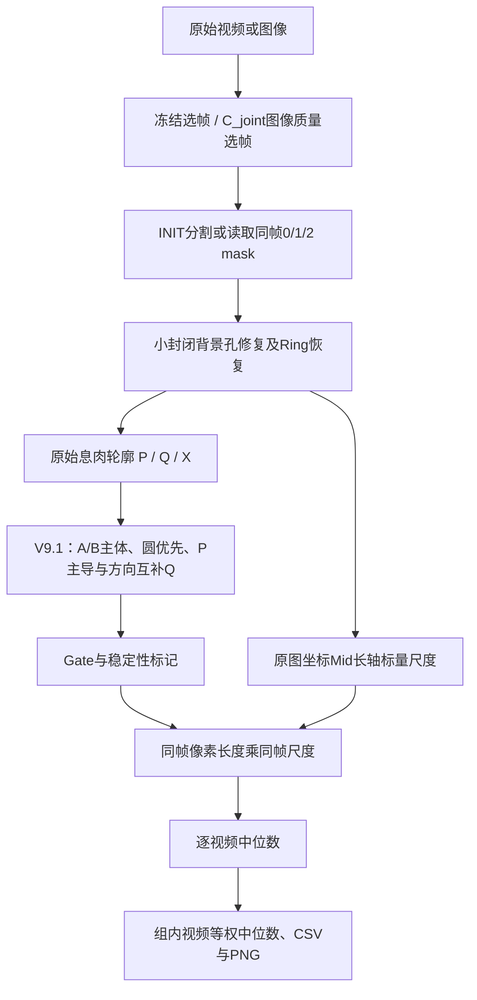
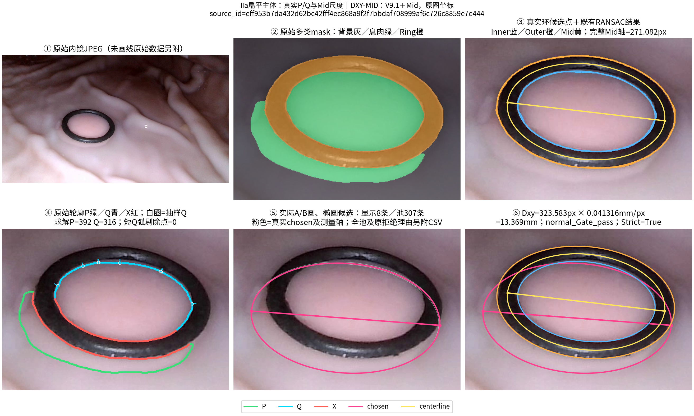
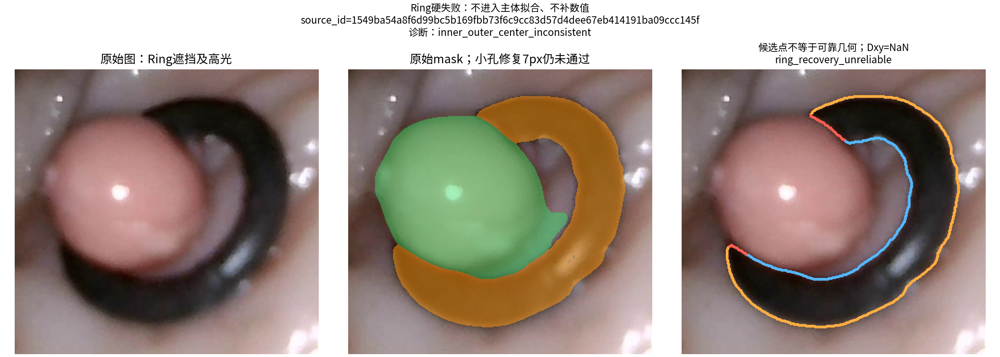

# DXY-MID：参考环辅助的息肉直径测量

DXY-MID是本仓库唯一推荐的测量Pipeline：**V9.1 Geometry + Mid Scale + 视频等权中位聚合**。它从当前图像及多类分割mask独立计算直径，保留可信边界P、遮挡弱约束Q、质量诊断和真实失败，不读取S5/G3等历史直径补齐结果。

DXY-MID已由人工确立为唯一正式主线，机器可读入口见[CURRENT_POINTER](mainline/CURRENT_POINTER.md)及[MAINLINE_MANIFEST](mainline/MAINLINE_MANIFEST.json)。为保证逐帧回归，保留冻结实现标识`1.0.0rc1`；它不表示仍处于候选主线状态。

**[39组完整Excel下载](mainline/tables/group_results.xlsx?raw=true)** · [39组CSV](mainline/tables/group_results.csv) · [逐视频结果](mainline/tables/video_results.csv) · [790帧与质量标记](validation/results/frame_measurements.csv)。有符号误差为`prediction − GT`，负值低估，正值高估。

仓库含既有单帧样例及**6组27帧真实JPEG与同帧mask**，其中一组提供两视频的全部20个冻结选帧。完整790帧、冻结权重及原视频仍有[分发限制](docs/DISTRIBUTION_REVIEW.md)，正式主线发布不等于全数据集Level 2已公开。

39组来自硅胶模型回顾性研究，不能解释为临床泛化性能。GT为人工确认的可信尺寸基准，只在独立评价阶段读取，不参与预测生成或算法选择。

## 测量方法



- **Ring**：只填充符合冻结面积/宽度标准的小封闭背景孔；不闭合断裂环、不修改原始mask。用可见内缘弧段RANSAC恢复椭圆，必要时使用同帧中心线对称恢复；保留中心、厚度、mask支持及稳定性检查。
- **Boundary**：P是可观察的息肉—背景边缘。Q始终锚定原始息肉轮廓的真实像素及索引；Ring只提供跨环背景邻接、遮挡及宽度证据，Q沿息肉外法向保留有限位置区间。每条Q弧长度低于`max(3 px, 该轮廓周长2%)`时整弧删除。其余为X/未知。
- **Geometry**：A优先保留环外宽厚主体，没有时保留充分可见的实质组件；B对实质组件并集作既有形态开运算，减少细连接干扰。两者使用RANSAC圆、稳健椭圆和圆优先选择。P充分时Q补充缺失方向，P=0时标明遮挡推断。冻结的Q冲突恢复仍保留原始拒绝诊断；它不是正常Gate或严格稳定结果。
- **Scale**：只使用原图像素，不仿射拉伸息肉。Mid椭圆沿用已验证内外环参数平均结果，完整长轴为`2a_mid`，没有另拟合第三种椭圆。线材圆截面直径1.2 mm，中心线物理直径R5为6.2 mm、R10为11.2 mm。

\[
s_i=\frac{D_{\rm inner}+1.2}{2a_{{\rm mid},i}},\qquad
D_i=L_{{\rm polyp},i}s_i
\]
\[
D_{\rm video}=\operatorname{median}_{i\in video}(D_i),\qquad
D_{\rm group}=\operatorname{median}_{video}(D_{\rm video})
\]

这是同帧标量换算，假设Ring与目标具有近似相同放大率；不同深度、非平面形状及透视可破坏假设。**不使用`median(L) × median(scale)`。** 正式聚合包括正常Gate、Q恢复及其他有限有效数值；严格稳定帧单独作诊断。Ring失败或无几何数值保持NaN，不填补。

下图来自真实数值函数：环候选点、原始轮廓P/Q/X、实际圆/椭圆候选及chosen测量轴均有逐点CSV证据；没有为绘图重新拟合。Mid黄色完整长轴用于尺度，粉色轴用于息肉测量。



[Ip逐阶段图、Q恢复、零P推断与小孔修复](docs/visualization/README.md)另列展示。Q恢复有数值仍不等于Normal或Strict；P=0结果属于遮挡推断。

## 安装（Ubuntu / Python 3.10）

```bash
python3 -m venv .venv
.venv/bin/python -m pip install '.[plot,test]'
```

测量已有mask不需要Torch或GPU。核心依赖已在`pyproject.toml`锁定；CPU推荐4进程，BLAS/OpenMP各1线程。环境详情及可选视频推理栈见[环境/模型/数据](docs/DATA_MODEL.md)。

## 可直接运行的真实mask示例（Level 1）

```bash
OPENBLAS_NUM_THREADS=1 OMP_NUM_THREADS=1 .venv/bin/dxy-mid measure \
  --manifest examples/mask_demo/frames.csv --output outputs/demo --workers 1 --render

.venv/bin/python scripts/verify_regression.py \
  --actual outputs/demo/frames.csv --expected examples/mask_demo/expected.csv \
  --output outputs/demo/regression.json
```

第一条命令从图像/mask重算Ring、Boundary、Geometry、Scale和Fusion。第二条才读取冻结评价值。示例复用仓库已有公开的真实图像，不能将单帧示例视为完整组级实验。

[既有单帧测量PNG](docs/assets/mask_demo.png)继续保留。

## 新增真实多帧与多视频公开案例

无需权重、GPU或外部下载，安装后可直接运行：

```bash
# 全部27帧：6组机制子集，含完整Is组及一个真实Ring失败
OPENBLAS_NUM_THREADS=1 OMP_NUM_THREADS=1 .venv/bin/python scripts/reproduce_public.py \
  --case all --output outputs/public --workers 2 --render

# 只复现完整两视频组：20帧 → 两段视频中位数 → 10.2093871774 mm
OPENBLAS_NUM_THREADS=1 OMP_NUM_THREADS=1 .venv/bin/python scripts/reproduce_public.py \
  --case multivideo --output outputs/public-videos --workers 2

# 真正的失败：Dxy=NaN，ring_recovery_unreliable；脚本验证失败身份后返回成功
.venv/bin/python scripts/reproduce_public.py --case failure --output outputs/public-failure --workers 1
```

每条命令先从JPEG/mask计算，再读取独立expected文件验证。完整Is 10.5 R5组的两段视频各10帧，中位数约10.274870与10.143904mm；组级结果为二者等权中位数。其余5组只有机制示例，**不能用其子集结果声称复现原完整组**。`reproduction_scope.json`明确记录统计范围。

原图、0/1/2 mask、SHA256、时间戳、GT评价信息和命令见[公开案例](examples/reproduction_cases/README.md)。GT只在单独的评价文件中，不进入测量输入。27帧共约3.74 MiB，来自获准公开的实验室自制硅胶模型，不含患者数据。未公开原始视频或分割权重，故这些样例支持Level 1，不能据此宣称Level 2已公开。

本轮[技术报告与验收证据](docs/PUBLIC_CASES_TECHNICAL_REPORT.md)、[简短人工摘要](docs/PUBLIC_CASES_HUMAN_REPORT.md)及[待决定公开资产](docs/PUBLIC_ASSETS_PENDING.json)分别记录复现范围、真实性检查和分发限制。



## Python API与自有mask

```python
from dxy_mid import measure_files
result = measure_files("frame.jpg", "labels.png", inner_diameter_mm=5.0)
print(result.audit["D_frame_mm"], result.audit["quality_class"])
```

批量使用`dxy-mid measure --manifest frames.csv --output outputs/run --workers 4`。路径相对于manifest，或由`--data-root`指定；环尺寸是显式输入，组名与Paris类型不选择算法。可传`--config configs/dxy_mid.json`核验冻结配置。字段定义见[数据契约](docs/DATA_MODEL.md)。

## 从原始视频运行（Level 2，需冻结权重）

先准备`videos.csv`，列为`group,video,path,ring_mm`，以及经过核验的INIT多类模型目录（权重SHA见[模型来源](docs/MODEL_PROVENANCE.json)）。不能用公开的Kvasir二分类模型替代。

```bash
.venv/bin/python -m pip install '.[video]'
OPENBLAS_NUM_THREADS=1 OMP_NUM_THREADS=1 .venv/bin/dxy-mid video \
  --videos datasets/videos.csv --model-dir models/INIT \
  --device cpu --output outputs/new_video --workers 4 --render
```

该入口执行冻结C_joint选帧及实际分割。重放冻结790帧时额外使用`--frame-manifest validation/frozen39/inputs.csv`；不会重新优化选帧。原视频或精确权重缺失时Level 2不能运行，CSV汇总不能替代它。当前本地原视频链验证与对外分发限制见[迁移技术报告](docs/RELEASE_TECHNICAL_REPORT.md)。

## 39组回归

已有完整图像/mask输入包时：

```bash
OPENBLAS_NUM_THREADS=1 OMP_NUM_THREADS=1 .venv/bin/python scripts/reproduce39.py \
  --data-root datasets/frozen39 --output outputs/regression39 --workers 4
```

这条命令重新计算全部输入，只能复用本次运行自身按当前输入/源码哈希生成的缓存。冻结预测仅在计算完成后比较。全量可选自动测试：`DXY_REGRESSION_DATA=datasets/frozen39 .venv/bin/python -m unittest discover -s tests -v`；默认测试含公开真实样例，完整数据缺失时明确跳过全39组测试。CI不需要私有权重或大数据。

|冻结核验项|参考值|
|---|---:|
|目标组数 / 输入帧数|39 / 790|
|独立数值覆盖|39/39组，757/790帧|
|Ring失败|33帧，保留NaN|
|Normal-Gate / Q冲突恢复|627 / 130帧|
|Strict稳定|616帧|
|历史预测回退|0|
|更正GT后的中位绝对相对误差 / MAE|4.4113% / 0.709224 mm|
|p95 / 最大绝对相对误差|14.7263% / 16.5656%|

参考误差4.1915%、MAE0.7041 mm来自更正前的GT映射：两组Ip2.9实际为Ip2.8，Is6.5实际为IIa6.5。本次遵从人工确认的可靠GT更正映射，**没有改变预测去匹配旧误差**。逐帧/视频/组级迁移回归及失败原因以[回归证据](validation/frozen39/README.md)为准。所有数值覆盖都不等于测量必然正确。

## 输出、质量与局限

`frames.csv`保留像素长度、同帧尺度、毫米值、轴端点、P/Q采样与残差、质量类别、NaN原因和哈希。`videos.csv`记录中位数/IQR/有效帧；`groups.csv`记录视频等权中位数；`groups_strict.csv`仅为严格帧诊断；`run.json`记录版本及覆盖。详见[输出字段与质量语义](docs/OUTPUTS.md)。PNG每组一张，代表帧按毫米值最接近视频中位数选取，绘制实际测量轴及两端点。

零P推断、Q恢复、模糊帧、环遮挡、非共面放大率和只有一段有效视频均是已知限制。严格稳定不证明隐藏轮廓唯一正确。本版本没有畸变标定或参考环平面仿射拉伸，也没有临床验证。

## 历史研究与溯源

历史S5、G3、DG3及原Fusion已退出默认入口，保留在原目录以免破坏追踪；见[历史归档说明](legacy/README.md)。DXY-MID复用其中经过验证的底层源码，不读取其最终预测。迁移提取了真实可达数值函数，消除了实验文件夹运行依赖和运行时源码裁剪；[函数级来源表](docs/SOURCE_PROVENANCE.csv)记录原文件与哈希。独立三维重建研究不属于本仓库迁移范围，未作修改。
