# DXY-MID：正式测量结果图集

DXY-MID从同帧息肉像素长度与参考环Mid长轴恢复毫米尺度，再取视频内中位数、组内视频等权中位数。黄色是实际Mid及尺度轴，绿色P为可信轮廓，青色Q为锚定原息肉轮廓的弱约束，粉色是实际chosen主体及真实测量轴；没有为绘图重拟合。

**完整39组：39/39数值有效，757/790帧有效；中位绝对相对误差4.411327%，MAE 0.709224mm，p95相对误差14.726267%，最大16.565640%。** Normal 627帧、Q恢复130帧、Strict 616帧、Ring失败33帧。39组是硅胶模型回顾性测量组，非临床泛化性能。

[直接下载39组中文Excel](../../mainline/tables/group_results.xlsx?raw=true) · [完整CSV](../../mainline/tables/group_results.csv) · [逐视频结果](../../mainline/tables/video_results.csv) · [图像索引](index.csv)

**有符号误差=预测−GT；负值低估、正值高估。** 图集11组刻意覆盖不同误差及机制，只用于解释，绝不以这11组重算总体性能。每组图选择实际参与聚合、接近所属视频中位数的帧；帧值与组级值在图中分别标注。选择规则不使用GT。

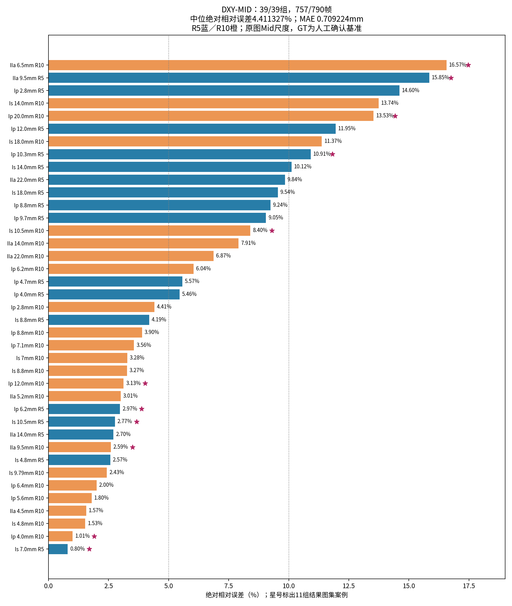

## 0–2%：绝对相对误差

### Is 7.0mm / R5

组级GT为7.000mm，DXY-MID为6.944mm，有符号相对误差-0.80%。全组有效20/20帧、2/2视频；Q恢复0帧、Strict 20帧、Ring失败0帧。图中单帧测量值与组级中位数不同，不按误差另选更漂亮的测量。

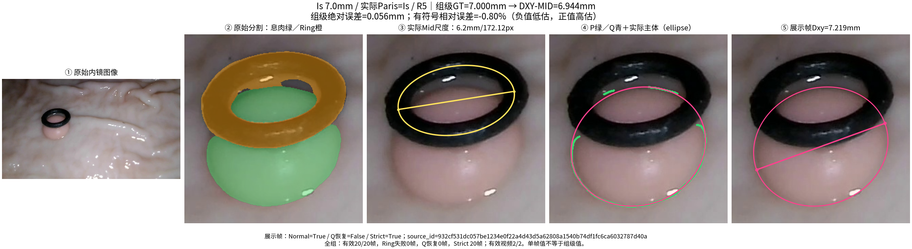

### Ip 4.0mm / R10

组级GT为4.000mm，DXY-MID为3.960mm，有符号相对误差-1.01%。全组有效20/20帧、2/2视频；Q恢复0帧、Strict 20帧、Ring失败0帧。图中单帧测量值与组级中位数不同，不按误差另选更漂亮的测量。

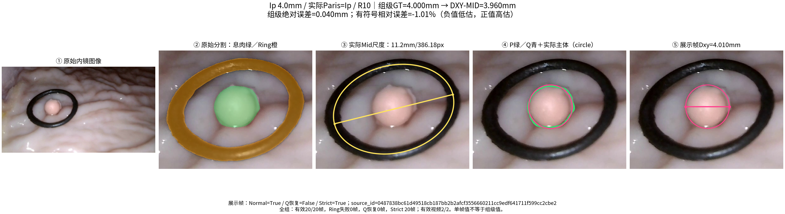

## 2–5%：绝对相对误差

### IIa 9.5mm / R10

组级GT为9.500mm，DXY-MID为9.746mm，有符号相对误差+2.59%。全组有效20/20帧、2/2视频；Q恢复0帧、Strict 20帧、Ring失败0帧。展示帧P=0，属于Q约束的遮挡推断，不能视为直接观察到隐藏边界。

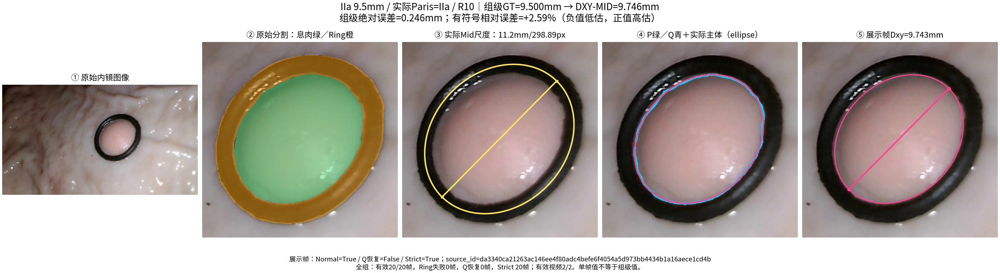

### Is 10.5mm / R5

组级GT为10.500mm，DXY-MID为10.209mm，有符号相对误差-2.77%。全组有效20/20帧、2/2视频；Q恢复0帧、Strict 20帧、Ring失败0帧。图中单帧测量值与组级中位数不同，不按误差另选更漂亮的测量。

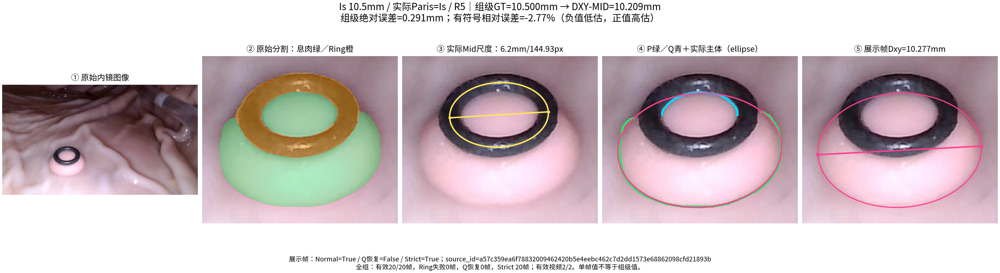

### Ip 6.2mm / R5

组级GT为6.200mm，DXY-MID为6.384mm，有符号相对误差+2.97%。全组有效20/20帧、2/2视频；Q恢复20帧、Strict 0帧、Ring失败0帧。多数帧使用Q冲突恢复；即使组级误差较低，也不能将其解释为所有帧严格稳定。

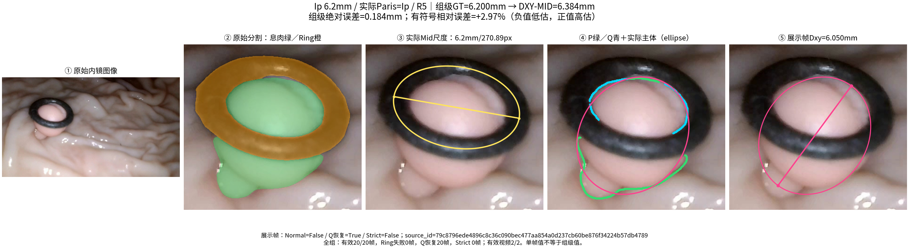

### Ip 12.0mm / R10

组级GT为12.000mm，DXY-MID为11.625mm，有符号相对误差-3.13%。全组有效20/20帧、2/2视频；Q恢复15帧、Strict 3帧、Ring失败0帧。多数帧使用Q冲突恢复；即使组级误差较低，也不能将其解释为所有帧严格稳定。

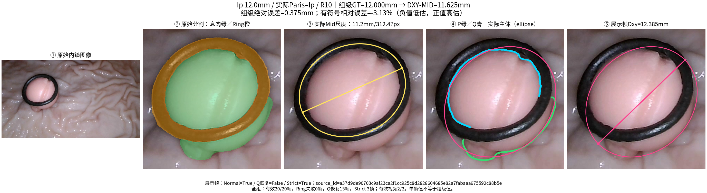

## 5–10%：绝对相对误差

### Is 10.5mm / R10

组级GT为10.500mm，DXY-MID为9.618mm，有符号相对误差-8.40%。全组有效20/20帧、2/2视频；Q恢复0帧、Strict 20帧、Ring失败0帧。该组GT≥10mm而预测<10mm，发生10mm漏判；质量状态本身不能证明测量正确。

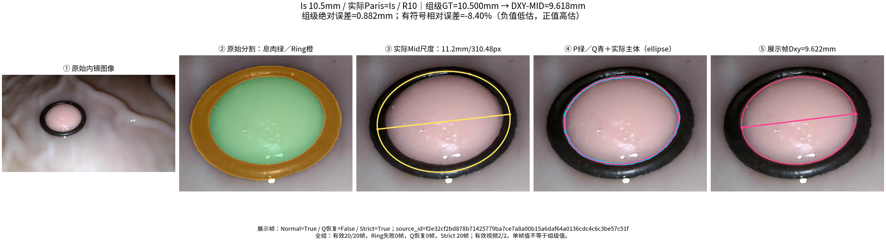

## 10–15%：绝对相对误差

### Ip 10.3mm / R5

组级GT为10.300mm，DXY-MID为9.176mm，有符号相对误差-10.91%。全组有效10/20帧、1/2视频；Q恢复4帧、Strict 6帧、Ring失败10帧。该组GT≥10mm而预测<10mm，发生10mm漏判；质量状态本身不能证明测量正确。

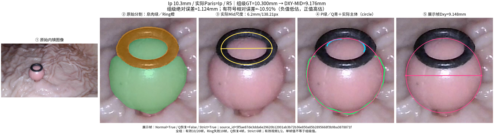

该组仅一段视频有效，跨视频重复性证据不足；另一段没有数值，未进行历史回退。

### Ip 20.0mm / R10

组级GT为20.000mm，DXY-MID为17.294mm，有符号相对误差-13.53%。全组有效20/20帧、2/2视频；Q恢复17帧、Strict 3帧、Ring失败0帧。多数帧使用Q冲突恢复；即使组级误差较低，也不能将其解释为所有帧严格稳定。

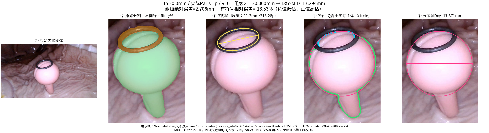

## >15%：绝对相对误差

### IIa 9.5mm / R5

组级GT为9.500mm，DXY-MID为7.995mm，有符号相对误差-15.85%。全组有效20/20帧、2/2视频；Q恢复0帧、Strict 20帧、Ring失败0帧。这是冻结结果中的大误差例，保留真实偏差，未改变尺度、轮廓或预测。

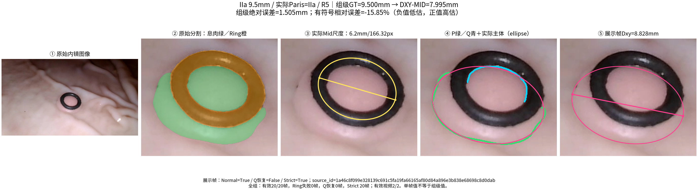

### IIa 6.5mm / R10

组级GT为6.500mm，DXY-MID为5.423mm，有符号相对误差-16.57%。全组有效20/20帧、2/2视频；Q恢复0帧、Strict 20帧、Ring失败0帧。这是冻结结果中的大误差例，保留真实偏差，未改变尺度、轮廓或预测。

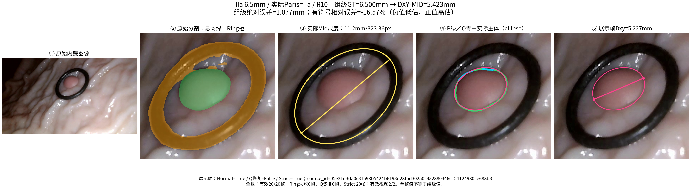

## 同组失败帧对照

Ip 10.3 R5有10/20帧Ring失败。下图来自实际失败缓存：无chosen、Dxy=NaN，不参与聚合；组级结果不被拿来填补该帧。仅凭失败与低估同时出现，不能断言失败就是误差的唯一原因。

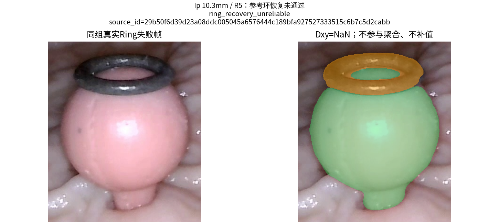

## 数据来源与复查

所有绘图使用迁移后独立790帧复算保存的Measurement对象，核对原图/mask SHA256、Ring参数、chosen基矩阵、测量端点、Q原轮廓索引及帧/组数值。每组数值证据在`evidence/`，PNG校验和随证据保留。

本轮只新增派生结果图及数值表，没有额外公开这些代表帧的JPEG/mask、视频或权重。公开27帧仍可独立完成Level 1案例；完整39组原始输入和Level 2仍有分发限制。完整原始输入持有者可用`scripts/render_results_gallery.py`和复算缓存重绘，不能把PNG当成从原图重新测量的替代。

最终算法与冻结GT未变；更正后实际Paris和显示名称以39组表为准，旧group_id只为保持关联。
