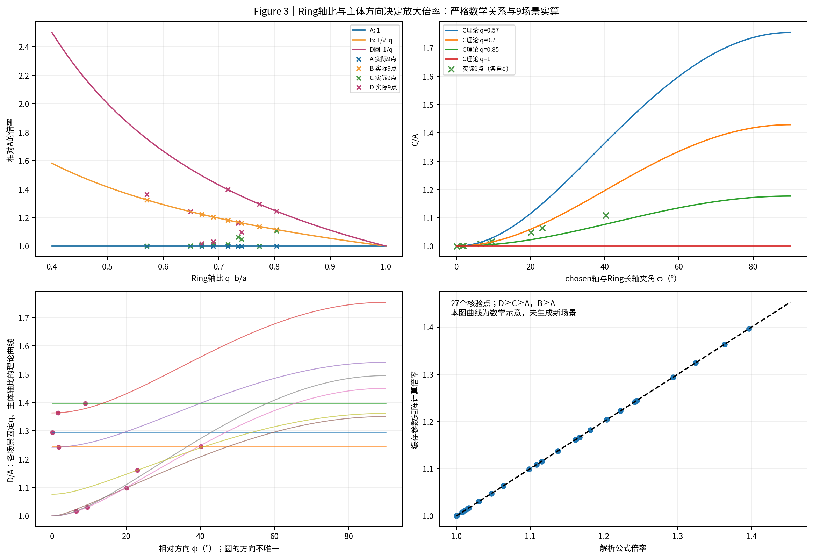

# 数学理论与误差传播

本节回答：同一个息肉拟合，换一种参考环尺度为何可能得到不同毫米直径？为什么Mask一起放大，有时抵消、有时却使chosen明显缩小？

**正式DXY-MID仍只有Mid-Major一条尺度主线。** 本节A/B/C/D是共享冻结chosen的只读理论对照，不增加CLI选项、不修改真实39组结果。九个静态场景来自三个CAD模型，不能当成九个独立息肉。

## 四尺度理论

[尺度恢复推导](scale_recovery.md)统一定义原图Ring半轴、chosen矩阵和仿射坐标，证明 $D_D\ge D_C\ge D_A$、$D_B\ge D_A$，以及圆和最大轴切换特例。

| 方法 | 直觉 | 额外限制 |
| --- | --- | --- |
| A Mid-Major | 用Ring长轴建立单一mm/px | 目标与环近似共享放大率 |
| B Mid-Area | 面积等效的各向同性倍率 | 不等于任意方向的逆投影 |
| C Chosen-Axis Affine | 只矫正原测量方向 | 仍沿用原chosen轴；圆的方向不唯一 |
| D Whole-Shape Affine | 变换完整圆/椭圆，再取最长轴 | 完整二维表达不等于任意三维尺寸恢复 |

## 九场景验证

[实验说明](experiment.md)保留V2原八项联合通过的全部九场景及共同分母。N0结果为：

| 方法 | 中位ARE（%） | MAE（mm） |
| --- | ---: | ---: |
| A | 4.7989 | 0.56169 |
| B | 14.6230 | 0.95653 |
| C | 6.9974 | **0.48723** |
| D | 14.8348 | 1.02907 |

A的中位ARE最低；C的MAE更低，8/9场景绝对误差下降。两者都需要报告。这里的指标与真实39组的4.411327% / 0.709224 mm分别统计。

## Mask误差传播

[误差传播](error_propagation.md)推导有限对数分解、局部方向敏感性与协方差关系。720次随机Mask扰动均有数值，但出现148次参数跳变；同一chosen标签不代表半轴和中心稳定。

N4共同放大后，七场景基本抵消，两个Is14场景的A中位变化却约为−24.26%、−27.78%。主要数值变化在主体长度，伴随P/Q和Q恢复路径改变，不能简单归因于Ring尺度误差，也不能把代数分解称为因果贡献。

## 核心图片



上图曲线是**数学示意（Illustrative Geometry）**，点来自实际冻结参数。没有新渲染场景。

[全部九场景Accuracy分布](figures/Figure5a_accuracy_distributions.png)与[Sensitivity分布](figures/Figure5b_sensitivity_distributions.png)分别描述对GT的误差与对N0的变化。图中的5%–95%是20次重复的经验分位，不是临床置信区间。

图片与资产分发范围见[分发说明](DISTRIBUTION.md)；每幅公开图片的来源及SHA256见[图片索引](figures/index.csv)。

## 数据与复算

仓库提供[九场景N0](data/n0_results.csv)、[927条逐次记录](data/perturbation_trials.csv)、[144行分布表](data/prediction_distributions.csv)、[源码与冻结来源](SOURCE_MANIFEST.json)。输入倍率、Ring半轴/方向、chosen矩阵和端点、GT误差、相对N0变化、Gate/Strict/Q恢复及跳变标记均可查询。

```bash
# 仅需Python与NumPy；不导入DXY-MID，不需要Blender或模型权重
python docs/theory/verify_math.py
```

当前[发布核验记录](VALIDATION.json)区分数学复算、公开真实样例和完整真实数据回归；[文件哈希清单](PUBLICATION_MANIFEST.json)覆盖本节公开内容。

脚本核验1000组数学关系，并从公开CSV重建四尺度、复算九场景指标、分布及协方差。精确字段与两个复现层级见[实验说明](experiment.md#5-公开数据字段与复算)。

**可以复算：** 数学恒等式、给定冻结几何上的四尺度与已发布统计。

**不能仅凭这些CSV完成：** 从原始Blender模型生成场景，再从RGB/Mask重新执行Ring和Geometry。完整资产未公开，不能将数值复算称作原始图像端到端独立测量复现。

## 理论适用范围

代数关系严格成立；Ring轴比与倾角、共享放大率、共面恢复依赖几何假设；误差排序与两类N4表现只属于本实验。不能据此证明A普遍最优、D普遍不合理，或把720次扰动当成720个新实体。正式算法、GT、视频等权聚合和39组冻结预测均保持不变。
