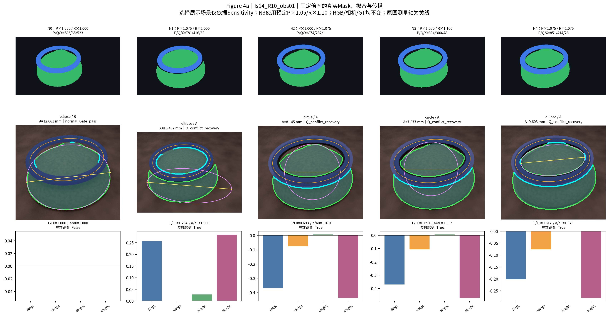

# 固定九场景：结果、扰动与可复算范围

[返回入口](README.md) · [尺度理论](scale_recovery.md) · [误差传播](error_propagation.md)

## 1. 来源与冻结范围

本研究只采用V2原30场景中**通过全部八项联合观测匹配条件的9场景**，来自3个源CAD模型：Ip4的3个R5观测、Is14的2个R10观测、IIa6.5的4个R10观测。它们是3个模型的不同观测配置，不能算作9个独立息肉，不能声称覆盖全部真实测量组。

筛选不读取A/B/C/D误差；未使用V3扩展的86个匹配场景，未新增模型、相机、Ring姿态或RGB。使用原始Oracle Mask，GT沿用源CAD冻结的最大XY尺寸，不从图像预测反推，不用匹配的真实目标组GT替代。九场景均保留，现有物理核验没有排除项。

源报告、数学文件、协议、预测与交付哈希已逐项核对。[SOURCE_MANIFEST.json](SOURCE_MANIFEST.json)给出准确来源及验证记录。指定的时间戳副本`TECHNICAL_REPORT(20261020-112751).md`未找到，实际读取的是被冻结交付清单保护的完整`TECHNICAL_REPORT.md`；不假定两个名称的文件内容相同。

原有八项标准如下；[原始通过标志](data/matching_audit.csv)保留9/9行及八个单项标志。另附[原30场景选择标志](data/selection_audit_30.csv)，可独立检查八项AND恰好得到这9个ID。其余21行只作选择来源审计，不进入本轮误差或扰动统计。该CSV核验不是从未公开像素重新计算匹配特征。

| 原V2指标 | 冻结条件 |
| --- | --- |
| Ring轴比差 | ≤0.10 |
| Ring长轴/画幅宽度差 | ≤0.05 |
| 长轴无向周期角差 | ≤15° |
| 归一化Ring中心距离 | ≤0.10 |
| 可见息肉面积比 | 0.5–2 |
| 息肉/Ring像素大小比之比 | 0.67–1.5 |
| Ring归一化相对主体中心距离 | ≤0.25 |
| 息肉位于Mid内部的比例差 | ≤0.25 |

每套Mask只计算一次正式V9.1 Geometry，四尺度共享实际chosen及质量身份。没有按GT选择方法、候选或帧，没有拼接不同方法的最佳值；已有同输入、同源码指纹的Measurement缓存经哈希核验后复用。它们是当前算法的同输入缓存，不是其他算法最终直径的回退。

## 2. 原始N0：九场景共同有效

以下数字由公开[n0_results.csv](data/n0_results.csv)独立复算。单位为mm或百分比；有符号误差=预测−GT，负值为低估。

| 方法 | 数值覆盖 | 中位ARE（%） | MAE（mm） | 平均ARE（%） | P95 ARE（%） | 最大ARE（%） | 对A改善/恶化 |
| --- | --- | ---: | ---: | ---: | ---: | ---: | --- |
| A Mid-Major | 9/9 | 4.7989 | 0.56169 | 6.8210 | 14.0076 | 15.8814 | 基准 |
| B Mid-Area | 9/9 | 14.6230 | 0.95653 | 11.7194 | 18.8522 | 19.9224 | 2 / 7 |
| C Chosen-Axis Affine | 9/9 | 6.9974 | **0.48723** | **5.8145** | **10.0633** | **10.5407** | **8 / 1** |
| D Whole-Shape Affine | 9/9 | 14.8348 | 1.02907 | 14.4439 | 32.2588 | 36.9362 | 4 / 5 |

A的中位ARE最低，但C的MAE、平均ARE及尾部指标更低，且8/9场景绝对误差下降，其中部分改善很小。一个原本误差较小的Ip场景被C放大为高估，改变了误差排序，使C的中位ARE仍高于A。这些指标回答不同问题，不能只凭中位ARE宣布所有场景或所有误差口径都支持A。

原V2完整30场景的4.5414%不属于此九场景结果。真实39组正式指标仍为Median ARE 4.411327%、MAE 0.709224 mm，保留在[正式结果表](../../mainline/tables/group_results.csv)；两套实验没有混入同一分母。

### 公式与数值对应：Ip4_R5_obs02

GT约4 mm（表内保留原始精度）；chosen为圆，$L=45.6735853$ px，$a=36.5627489$ px，$b=28.2627583$ px，$q=0.7729933$，$D_{\mathrm{mid}}=6.2$ mm。

| A（mm） | B（mm） | C（mm） | D（mm） |
| ---: | ---: | ---: | ---: |
| 3.8724691 | 4.4045354 | 3.8724771 | 5.0097062 |

$$
\frac{D_D}{D_A}=1.2936724=\frac{1}{0.7729933},\qquad
D_D\approx3.8724691\times1.2936724=5.0097062\;\mathrm{mm}.
$$

C因原轴几乎平行Ring长轴而接近A；D使完整圆的另一方向成为最长轴，误差增大。该例说明二维仿射表达完整，不等于真实三维主体尺寸更准确。

### 椭圆也可能换轴

Is14_R10_obs01的Ring $q=0.57047$、主体 $d/c=0.77760$，原测量轴夹角仅1.63°。A/C约12.6807/12.6914 mm，D却为17.2916 mm。因 $d/c>q$，主体短轴可在整体变换后成为最大轴。相反，IIa的四个椭圆观测中D都比A更接近GT；不因它们有利于D而删除。

## 3. 已完成的Mask扰动，不再新增试验

[完整公开逐次表](data/perturbation_trials.csv)有927行：9条N0、720条随机重复、162条固定控制、36条V2已有扰动。相同内容去重为856套Geometry输入，四尺度共用。N0不是重复20次的伪样本。

- N1：仅polyp扩大；N2：仅Ring扩大；N3：二者独立扩大；N4：共同倍率扩大。
- 随机倍率为1.05–1.10，预注册种子2026102001–2026102020；每场景每条件20次，由场景ID和种子确定随机流。
- 固定控制使用1.05、1.075、1.10；N1/N2/N4各3个，N3为预登记3×3倍率配对。重复Mask按内容复用，不搜索最佳倍率。
- 保持原始RGB、相机、GT不动。两类可见Mask分别围绕原质心作最近邻缩放，Ring优先合并，内孔与外缘同步缩放；不是Ring材料增厚。
- 正式Geometry仍使用原scene_id/stem，未把20个Mask种子变成20套新几何算法种子。

| 随机条件 | 记录数 / 数值有效 | Normal | Q恢复 | Strict | 候选切换 | 参数跳变 | 同身份参数跳变 |
| --- | --- | ---: | ---: | ---: | ---: | ---: | ---: |
| N1 | 180 / 180 | 140 | 40 | 140 | 76 | 40 | 18 |
| N2 | 180 / 180 | 140 | 40 | 138 | 52 | 40 | 16 |
| N3 | 180 / 180 | 140 | 40 | 140 | 61 | 29 | 9 |
| N4 | 180 / 180 | 140 | 40 | 140 | 58 | 39 | 12 |

720次随机重复共有247次候选标签切换、148次参数跳变，其中55次的shape/body标签未改变。Normal但未Strict的另外2次为Ip4_R5_obs02/N2的容差边界饱和警告。候选切换、参数跳变与Gate变化不是互斥原因。数值有效不等于测量正确；不因Strict不足而静默删除结果。

## 4. 共同放大的两类结果

[N4逐场景表](data/N4_cancellation.csv)保留全部九场景，不只展示抵消良好的案例。

**近似抵消：** 7个Ip/IIa场景的A变化中位数均在−0.45%至+0.15%内；各次重复的最大绝对变化约1.59%。这与$L$和$a$近似同比变化相符，但不是普遍定理。

**明显非线性：** Is14两个场景的N4中位变化为−24.26%、−27.78%。以Is14_R10_obs02一条接近中位数的重复为例，仍选择A主体/椭圆，但$L'/L=0.7653$，$a'/a=1.0532$，主体短半轴比0.5589、中心移动0.194$L_0$；因此$D'_A/D_A\approx0.7653/1.0532=0.7266$。Mask扩大后chosen长度反而缩小，不能简单称为Ring尺度误差。

最大随机偏离为Is14_R10_obs02/N3/seed2026102003：A相对N0下降41.09%，$L'/L=0.6457$，$a'/a=1.0960$，chosen转为A圆，进入Q冲突恢复，Strict未通过。原缓存的P90残差约45.18 px、Q区间支持约0.064，不能据数值输出宣称几何恢复正确。

这些Is14 Mask在N0和扰动后仍都是两个可见连通分量：**连通分量数量不变也不代表局部接触关系和拟合稳定**。P/Q重分类、主体拟合与Q恢复路径共同变化；没有额外改变求解器作因果消融，因此不将全部误差分配给单条Q规则。本轮不修复算法。

### 固定结果的原图证据



上图仅复用已有固定倍率控制，N3展示预定的polyp×1.05/Ring×1.10。曲线与测量轴来自对应冻结Measurement，不是为了画图重新拟合；图像外空白表示拟合外推。它说明即使Ring与主体Mask仅作有限改变，选中的主体也可能变为局部圆或局部椭圆。不能把这些结果称作正确恢复。

[九场景N0真实拟合](figures/Figure2_nine_N0_fits.png)与[近似抵消对照](figures/Figure4b_fixed_propagation.png)提供另一方向的证据，不只展示退化或改进。未上传RGB/Mask独立源文件，因此这些派生审核图仍不等同于原始像素端到端复现。

## 5. 公开数据字段与复算

| 文件 | 内容 |
| --- | --- |
| [scenes.csv](data/scenes.csv) | 九场景身份、三维GT定义、图像/Mask/源模型SHA256及八项联合通过身份 |
| [matching_audit.csv](data/matching_audit.csv) | 原始9行八项通过标志，未用误差重选 |
| [n0_results.csv](data/n0_results.csv) | 原始9帧实际Ring、chosen矩阵、测量端点、质量与ABCD预测 |
| [n0_metrics.csv](data/n0_metrics.csv) | 四方法共同九场景统计 |
| [perturbation_trials.csv](data/perturbation_trials.csv) | 927条逐次结果，包含倍率、半轴/方向、chosen身份、N0参照、误差与状态 |
| [prediction_distributions.csv](data/prediction_distributions.csv) | 9场景×4条件×4方法的144行经验分布，均保留20次分母 |
| [log_variance_decomposition.csv](data/log_variance_decomposition.csv) | 144组对数方差与协方差恒等式核验 |

scenes表中的Mask SHA256对应原Oracle文件；逐次表中的Mask SHA256对应送入API的PNG编码。N0像素经源实验逐点校验完全相同，但PNG重新编码可产生不同字节哈希，不能据此误判Mask内容被修改。

`*_px`为像素，`*_mm`为毫米，`*_pct`为百分比；`signed_*`为预测对GT的有符号相对误差，`sensitivity_*`为对相同场景相同方法N0的相对变化。`body_basis_ij_px`是当前chosen半轴矩阵，`axis_x1`等是实际冻结测量端点，`L_px`仍以原冻结长度为准。`chosen_body`的A/B表示已有主体候选，与本页的尺度方法A/B不是同一概念。

经验5%–95%分位由20次有效重复计算，不是临床置信区间；失败频率保留原分母。实际此处失败为0，但表中仍保留Ring、NaN相关质量字段。Accuracy与Sensitivity分别描述对GT与对N0的差异。

只复算数学与已发布数值，无需Blender、Torch、分割权重或正式Geometry：

```bash
python docs/theory/verify_math.py
# 可选：将核验结果保存到仓库输出目录
python docs/theory/verify_math.py --json outputs/theory-verification.json
```

脚本从实际端点和chosen矩阵重建四法，验证1000组公式、大小关系、有限对数传播、144行分布与方差，并重新计算N0统计。它不运行图像测量，不冒充从原始场景端到端独立重算。

## 6. 固定审计表

| 审计项目 | 本研究记录 |
| --- | --- |
| 目标组数 | 原30场景中固定9场景，3个源CAD模型 |
| 本算法独立数值成功 | N0为9/9；927条Mask记录均有有限数值，四法相同样本 |
| 本算法失败 | 0/9场景；本组Mask试验数值失败0，未静默丢弃记录 |
| 历史测量值回退 | 0；仅核验同输入、同当前算法的Measurement缓存 |
| 失败组及具体原因 | 无数值硬失败；质量不足与跳变仍保留，不能称作正确测量 |
| 最终统计样本 | N0九观测；随机条件20次/场景，固定控制与既有扰动单列 |
| 是否使用GT选择算法 | 否；预测、参数与源代码先冻结，GT只作评价 |

## 7. 当前不能推广的结论

不能证明A在所有真实息肉都最准确、D对所有三维主体都不合理、真实Mask误差一定服从5%–10%放大、九场景代表真实39组的误差分布。三模型依赖、静态观测、Oracle可见Mask、已选择的匹配配置和具体扰动机制均限制外推。本实验不包含新的视频等权聚合试验，也没有临床泛化证据。
