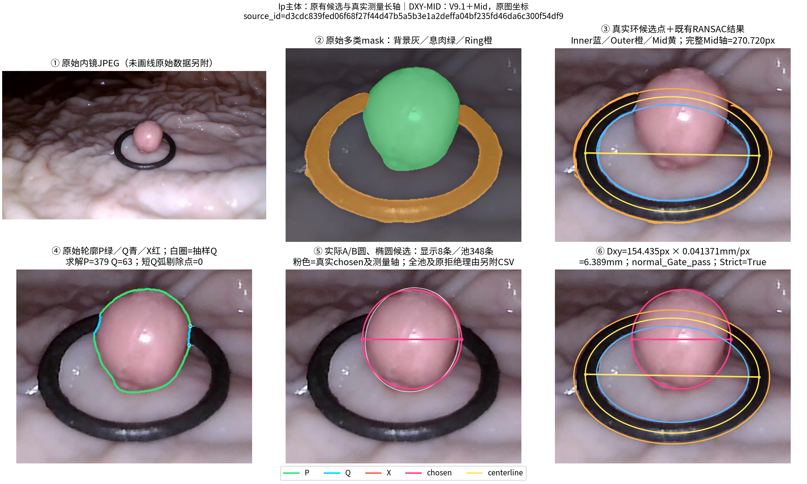
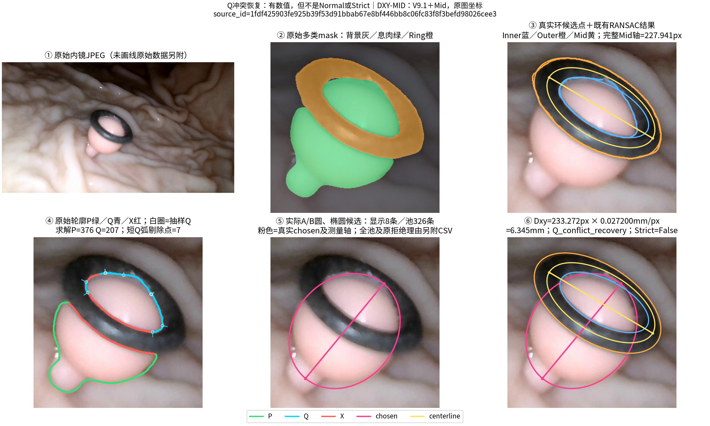
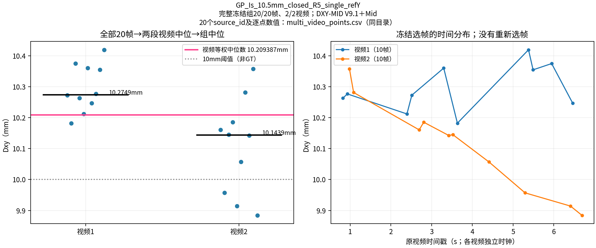

# 真实算法过程图与数值证据

以下图像来自本仓库冻结DXY-MID函数的真实输出：V9.1 Geometry、Mid原图标量尺度及既有质量规则。没有额外RANSAC、插值补点、重拟合或为绘图修改候选。原始JPEG与0/1/2 mask在[公开案例目录](../../examples/reproduction_cases/README.md)，并非只公开画线PNG。

| 图 | 解释机制 | source_id与逐点证据 |
| --- | --- | --- |
| [完整Pipeline六阶段](pipeline_overview.png) | IIa扁平，P/Q共存，Mid尺度与真实长轴 | [audit](evidence/pipeline_overview/audit.json) / [P/Q/X](evidence/pipeline_overview/boundary_solver_points.csv) |
| [Ip六阶段](typical_Ip_stages.png) | 真实主体候选、圆/椭圆及原图测量方向 | [audit](evidence/typical_Ip_stages/audit.json) / [实际候选池](evidence/typical_Ip_stages/geometry_candidates.csv) |
| [Q冲突恢复](q_recovery.png) | 旧候选P90冲突仍被保留，输出Q恢复数值且Strict=False | [audit](evidence/q_recovery/audit.json) / [过滤前Q](evidence/q_recovery/Q_before_short_arc_filter.csv) |
| [P=0遮挡推断](zero_P_occlusion.png) | Q仍是软区间；Normal/Strict标记不证明隐藏边缘准确 | [audit](evidence/zero_P_occlusion/audit.json) / [Q身份](evidence/zero_P_occlusion/boundary_solver_points.csv) |
| [Ring硬失败](ring_failure.png) | 实际环边缘候选存在，但内外中心不一致；Dxy=NaN | [audit](evidence/ring_failure/audit.json) / [环候选点](evidence/ring_failure/ring_points.csv) |
| [小孔修复前后](ring_hole_repair.png) | 内存中填充340px小孔，文件与息肉mask不变 | [audit](evidence/ring_hole_repair/audit.json) |
| [完整两视频聚合](multi_video_aggregation.png) | 20/20冻结帧→两个视频中位→等权组中位 | [逐点source_id与毫米值](multi_video_points.csv) / [输入20帧](../../examples/reproduction_cases/multivideo.csv) |

所有图的完整source_id、毫米值与身份另见[index.csv](index.csv)。每幅六阶段图中，①是完整原图，②～⑥仅缩放显示视窗，坐标仍是原图像素；不改变点位。绿色P、青色Q、红色X、粉色chosen/测量长轴、黄色Mid/尺度轴。白圈显示实际RANSAC抽样过的Q；为避免遮挡，仅稀疏画出部分真实法向区间，不改变求解输入或评分。

## 如何核查点、形状和数值

每帧`evidence/<name>/`包含：

- `ring_points.csv`：实际Ring返回的内缘/外缘候选点、排除点及可用时的中心线点。候选点不等于RANSAC内点；`audit.json`记录实际拟合椭圆、分支及诊断。黄色Mid椭圆来自冻结内外参数平均，不是另拟合一个新椭圆。
- `boundary_solver_points.csv`：完整原始息肉轮廓的`contour_id/index`、P/Q/X分类与原因；额外标记是否是选中主体的solver P/Q、是否抽样及是否参与Q评分，并保留真实法向、lo/hi区间。Q锚点始终是原轮廓像素。
- `Q_before_short_arc_filter.csv`：短Q弧过滤前原始Q及`removed`标记。六阶段图第④幅显示过滤后的分类，不能解释为未经处理的原始分类。
- `geometry_candidates.csv`：本次默认配置实际A/B候选池，包含中心、半径、方向、残差、原拒绝原因、现状态和诊断profile身份。图片只显示少量真实非profile候选，具体显示的记录由同名`.displayed_candidates.csv`列出；全池没有隐去。
- `audit.json`：最终chosen长轴端点、L_px、Mid长轴、mm/px、Dxy、Gate/Strict/Q恢复、原冲突原因及自动真实性检查。chosen形状来自实际对象的中心与基矩阵，不从最终毫米值反推。

Q恢复案例有`P_p90_residual_too_large`原冲突。冻结算法从当前候选池产生恢复值，但它不是Normal或Strict；本轮只展示并保留这一行为，没有调整其选择规则。P=0案例为遮挡约束推断，即使Strict=True也不代表真实不可观察边缘已被证实。

## 只读诊断入口

`dxy_mid.diagnostics.observe_files()`执行同一正式测量API，用线程本地Python函数返回事件观察实际中间量，随后恢复原profiler。它不改写数值模块、不替换solver hook、不读取GT或expected。正式非诊断API无需启用观察器。

自动检查原图/mask尺寸、原轮廓顺序、Q真实像素与索引、短弧是否完全退出求解、长轴端点距离与L_px、Mid像素轴与Scale来源，以及同帧毫米公式。硬失败确认无chosen且毫米为NaN。渲染脚本还对照已完成的本次正式结果；冻结回归另行验证所有公开帧。

复现命令：

```bash
OPENBLAS_NUM_THREADS=1 OMP_NUM_THREADS=1 .venv/bin/python scripts/reproduce_public.py \
  --case all --output outputs/public --workers 2
OPENBLAS_NUM_THREADS=1 OMP_NUM_THREADS=1 .venv/bin/python scripts/render_public_process.py \
  --cases examples/reproduction_cases --run outputs/public --output outputs/public-process
```

绘图需要Matplotlib及中文字体（Ubuntu可安装`fonts-noto-cjk`）。图集不构成新的性能评价；病例按机制选取，未按GT误差挑选。






